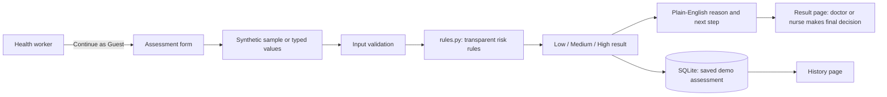

# Slide-ready submission text

Paste each block under the matching slide of the official template. Items marked
**[CHECK]** need your own input or verification before submission.

---

## Team Name:

**[CHECK: enter team name]**

## Team Size:

**[CHECK: enter number of members]**

## Problem Statement:

Community health workers often have to decide who needs urgent care using only
symptoms and basic vital signs, and they may have no decision support at the
point of care. This demo turns those few signals into a clear Low, Medium, or
High risk hint with a short reason and a next step. The tool only supports the
worker: a doctor or nurse always makes the final decision.

---

## Team members

| S.No | Name | Country | Role | Organization | Age confirmation |
|---|---|---|---|---|---|
| 1 | [CHECK] | [CHECK] | [CHECK] | [CHECK] | [CHECK: all members 18 or over, or state age if under 18] |
| 2 | [CHECK] | [CHECK] | [CHECK] | [CHECK] | [CHECK] |
| 3 | [CHECK] | [CHECK] | [CHECK] | [CHECK] | [CHECK] |
| 4 | [CHECK] | [CHECK] | [CHECK] | [CHECK] | [CHECK] |
| 5 | [CHECK] | [CHECK] | [CHECK] | [CHECK] | [CHECK] |

Delete rows that are not needed. [CHECK: confirm team size matches slide 1.]

---

## Team Capability Summary

Maximum 1,000 characters. **Count: 546 characters** (including spaces, counted
with Python).

We are a small team [CHECK: size] with skills in software, public health and data handling [CHECK: confirm real skills]. We built this prototype in Python, Flask and SQLite: a simple form, transparent rule-based triage, a clear Low/Medium/High result with reasons, and guest access to every feature. We wrote 10 automated tests covering the risk rules, guest mode, demo login, saving, and showing results. We make no clinical claim: a doctor or nurse makes the final decision, and the thresholds need clinician review before any real use [CHECK].

---

## Architecture or workflow diagram

The worker opens the app and can enter with one guest click. The browser form
sends seven values to a small Flask server: age, days ill, temperature, heart
rate, breathing rate, systolic blood pressure, and oxygen saturation, plus up to
six symptom ticks. The server checks the numbers, passes them to a transparent
rule file, and stores the assessment in a local SQLite database. The result page
shows the risk level, the reasons that led to it, a recommended next step, and a
reminder that a human clinician decides. No outside service or model is called.

---

## Target users and intended outcome

Primary users are community health workers and nurses in clinics or outreach
settings who need a quick, explainable triage hint. Secondary users are clinic
supervisors who review saved assessments and challenge organizers testing the
demo. The intended outcome is faster, more consistent first-pass sorting of
patients into self-care, clinic review within 24 hours, or urgent referral, with
the reasoning visible to the user. This prototype does not replace clinical
judgement and does not claim to improve patient outcomes. [CHECK: name the
specific country or care setting you are designing for.]

---

## How will success be measured?

Proposed pilot measures (targets need agreement with a clinical partner before
submission). [CHECK]

| Metric | How measured | Target |
|---|---|---|
| Guest access works | 5 judges open the app and reach all features without credentials | 5 of 5 succeed |
| Risk band agreement | 20 synthetic cases reviewed by a nurse compared with app output | at least 18 of 20 match [CHECK] |
| Time to result | Timed from opening the form to seeing the result in 10 demo runs | median 60 seconds or less |
| Explainability | Result pages containing at least one reason and the human-decision note | 100% of results |
| Personal data protection | Code review of fields and stored records | 0 real patient data fields in the demo |

These are engineering and usability targets, not clinical outcome claims.

---

## Evidence supporting the approach

- WHO guideline, *Recommendations on digital interventions for health system
  strengthening*, 2019, ISBN 978-92-4-155050-5. Recommendation 7 supports
  digital decision support for community and facility-based health workers,
  only for tasks already inside their scope of practice and in specific
  contexts. Source: https://www.who.int/publications/i/item/9789241550505
- Garg AX, Adhikari NKJ, McDonald H, et al. *Effects of Computerized Clinical
  Decision Support Systems on Practitioner Performance and Patient Outcomes: A
  Systematic Review.* JAMA 2005;293(10):1223-1238. doi:10.1001/jama.293.10.1223.
  The review found practitioner performance improved in 62 of 97 studies, while
  patient outcomes were studied less and results were inconsistent. We therefore
  do not claim patient benefit.
- Mebrahtu TF, Skyrme S, Randell R, et al. *Effects of computerised clinical
  decision support systems (CDSS) on nursing and allied health professional
  performance and patient outcomes: a systematic review.* BMJ Open
  2021;11:e053886. doi:10.1136/bmjopen-2021-053886. Results were mixed across
  35 studies; this supports a cautious, human-supervised design.
- WHO, *Global strategy on digital health 2020-2025*, ISBN 978-92-4-002092-4.
  Provides policy context for country-owned, sustainable digital health
  solutions. It was extended to 2027 by World Health Assembly decision in 2025.
  [CHECK: verify the current WHO strategy version at submission time.]
- Our own testing: 10 automated checks pass, covering rule outputs, guest
  access, demo login, saving, and display. This is software testing, not
  clinical evidence.

No clinical trial of this tool has been run. We have not invented any study,
citation, or number. The vital-sign thresholds in the code are a simple demo
heuristic and need review by a qualified clinician. [CHECK]

---

## Data sources and legal right to use them

| Source | Type | Owner | Sensitivity | Permissions | Personal data used (yes/no) |
|---|---|---|---|---|---|
| SYN-001 to SYN-003 in `app.py` | Handwritten synthetic example cases | Team [CHECK] | Low: invented values, no person | Team-created for this demo; [CHECK: confirm team policy] | No |
| Values typed during a demo | User-entered form values | Demo user | Potentially sensitive if real values entered | Demo use only; stored locally in SQLite; do not enter real patient data | No (synthetic only) [CHECK: enforce this rule] |
| External health datasets | None used | N/A | N/A | N/A | No |

The demo calls no external data API and contains no patient records. [CHECK:
have your data protection officer or legal adviser confirm this table.]

---

## Risks and safeguards

| Risk | Safeguard |
|---|---|
| Privacy: someone enters real patient details | Clearly labelled synthetic-only demo; no names, ID numbers, contacts, or addresses collected; local storage only; delete database to reset [CHECK: add deletion policy] |
| Security: session or database is exposed | Demo runs on localhost only; no production credentials; change the Flask secret key before any deployment [CHECK]; do not expose the demo to the public internet |
| Bias: thresholds may perform differently by age or condition | Single transparent rule set shown on screen; no hidden model; clinical review and subgroup testing required before real use [CHECK] |
| Explainability: user cannot see why a result appeared | Every result lists the exact reasons and a recommended next step in plain English |
| Misuse: tool used as a diagnosis or to deny care | Prominent notice on all pages: not a diagnosis; a doctor or nurse makes the final decision; urgent results say seek care today |
| Human oversight: automatic action without review | The app only advises; it does not book, prescribe, or refer by itself |
| Failure modes: wrong or missing input | Number ranges are checked; invalid input returns the form with an error; 404 page handles unknown records; no outside service is required |
| Over-reliance on green Low result | Low result tells the user to recheck in 2 days or sooner if the patient worsens |

---

## Hardware requirements

None, software only.

---

## Login

Judges can click **Continue as Guest** on the home page. This opens the
assessment form, sample-case loader, result pages, and history with no account
and no password. Login is optional.

Test credentials: username `demo`, password `demo123`. [CHECK: remove or change
these credentials before any public deployment.]

---

## Path to pilot and scale

Stakeholders: community health workers, supervising nurses, clinic managers, a
local Ministry of Health team, and a data protection adviser. [CHECK: name
actual people or organisations.]

Integration: the demo is standalone. A pilot would add role-based accounts,
secure hosting, audit logs, and an export format such as FHIR only after local
agreement. [CHECK: confirm the required national health data standard.]

Regulation: this tool advises but does not diagnose. Its regulatory class, if
any, depends on the country and intended use. [CHECK: obtain a regulatory view
before pilot.]

Timeline assumptions: months 1-2 clinical review of the rules and usability
testing; months 3-4 a small supervised pilot in one clinic; months 5-6 review
and fixes; months 7-12 expansion to more sites if approved. [CHECK: replace
with your real timeline.]

Sustainability: small Python code base, SQLite or a free open-source database,
no paid cloud service in the demo, open-source licenses listed on slide 13, and
local ownership of the code. [CHECK: identify who will maintain it.]

---

## Pre-existing IP and third-party materials

| Item | Owner | License / right to use |
|---|---|---|
| Application code, text, and synthetic sample cases | Team [CHECK] | Created for this submission; [CHECK: choose a license if you want to share it] |
| Python standard library (sqlite3, json, os, pathlib, datetime) | Python Software Foundation | PSF License |
| Flask 3.1.3 | Pallets | BSD-3-Clause |
| Werkzeug 3.1.9 | Pallets | BSD-3-Clause |
| Jinja2 3.1.6 | Pallets | BSD-3-Clause |
| itsdangerous 2.2.0 | Pallets | BSD-3-Clause |
| click 8.5.1 | Pallets | BSD-3-Clause |
| blinker 1.9.0 | Community project | MIT |
| SQLite | SQLite project | Public domain |
| WHO and journal sources on slide 7 | WHO / publishers | Cited only, not copied into the app |

No clipboard art, stock images, or copyrighted medical content are used.
[CHECK: confirm versions on your machine before submission; versions above came
from the demo environment.]

---

## Conflict of interest declaration

**[CHECK: choose one.]** None declared. / Details of any relationship with the
organizers, partners, judges, health facilities, or companies must be written
here.

---

## Additional Slide

Optional evidence for the demo:

- Screenshots: [CHECK: add home page, guest mode, sample case loaded, High risk
  result, and history page].
- Demo link: [CHECK: add the Cloudflare Pages URL after deployment. The static
  Pages version is in `web/` and keeps all guest features. The Flask version also
  runs locally with `python app.py`.].
- Automated check output: `Ran 10 tests ... OK` from
  `python -m unittest discover -s tests -v`.
